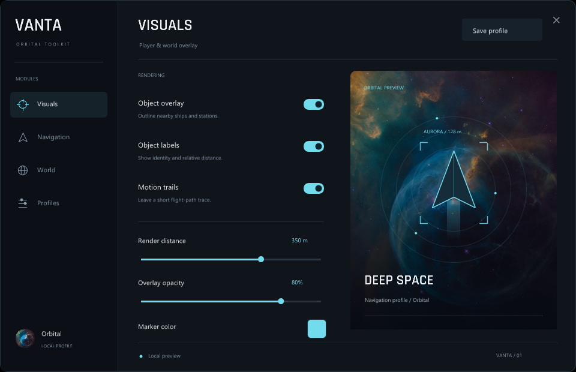
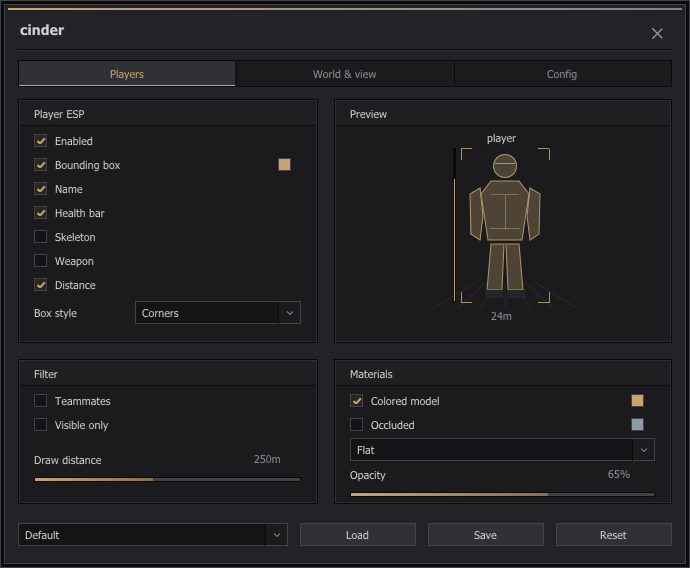
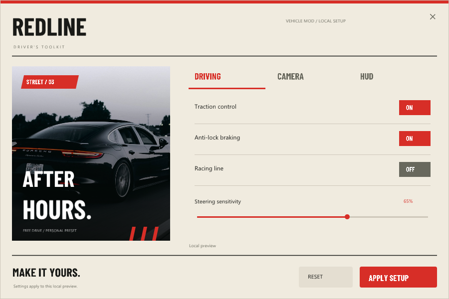
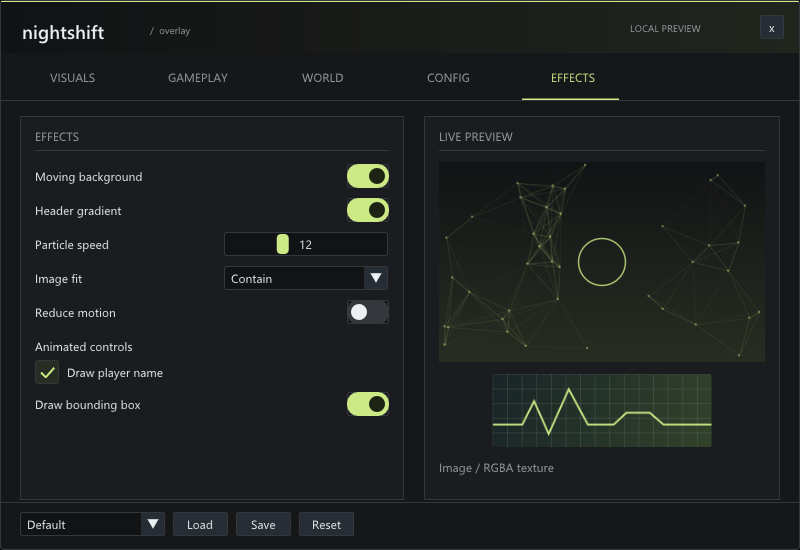
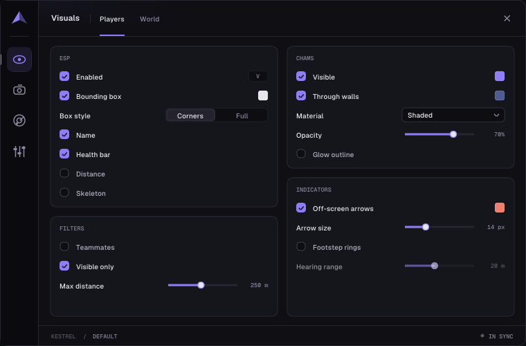
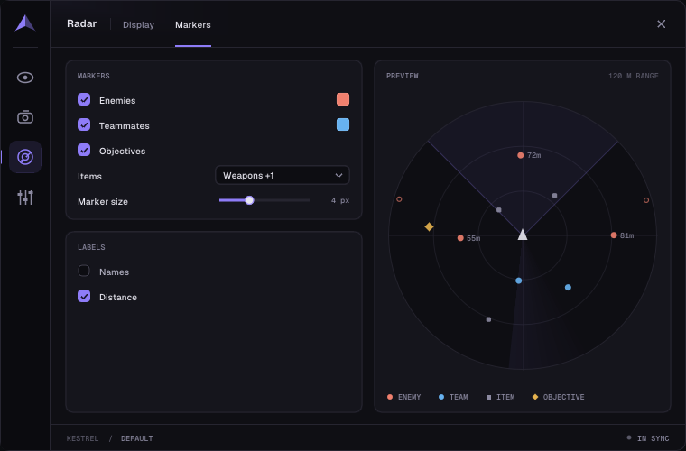

<div align="center">

# Atelier.ImGui

**Custom menus for ImGui.NET.**

A C# UI layer for game overlays and standalone tools, with reusable controls, themes, and animation.

[](https://dotnet.microsoft.com/download/dotnet/8.0)
[](https://github.com/ImGuiNET/ImGui.NET)
[](LICENSE)

[Quick start](#quick-start) · [Examples](#examples) · [Integration](#use-your-existing-host) · [Effects](docs/effects.md) · [Documentation](#documentation)



</div>

## Make it your own

Atelier adds a design system to ImGui.NET: settings rows, buttons, animated switches and checkboxes, tabs, themes, image drawing, gradients, and particle backgrounds.

Create your UI once and draw it each frame. Your application owns its settings and actions. Your host keeps its window, renderer, input handling, and ImGui context.

The core targets .NET 8 and depends only on ImGui.NET. An optional Windows/OpenGL adapter runs the same UI as a borderless, draggable executable.

## Quick start

On Windows, install the [.NET 8 SDK or newer](https://dotnet.microsoft.com/download), then run:

```powershell
git clone https://github.com/ifBars/Atelier.ImGui.git
cd Atelier.ImGui
dotnet run --project samples/Vanta -c Release
```

Drag the header to move the window. Use the close button or Alt+F4 to exit.

## Examples

Each example uses the same core library. All controls operate on local demo state.

| Vanta | Cinder |
| :--- | :--- |
|  |  |
| Dark cyan, image-backed orbital preview. [Source](samples/Vanta/VantaMenu.cs) | Compact classic controls, brass accents, Tahoma. [Source](samples/Cinder/CinderMenu.cs) |

| Redline | Nightshift effects |
| :--- | :--- |
|  |  |
| Red and ivory, condensed type, automotive photography. [Source](samples/Redline/RedlineMenu.cs) | Particle backgrounds, transitions, image fitting. [Source](samples/GameMenu/NightshiftMenu.cs) |

| Kestrel | Kestrel radar |
| :--- | :--- |
|  |  |
| Compact violet/ink, keybind chips, multi-select, profiles. [Source](samples/Kestrel/KestrelMenu.cs) | Live radar preview driven by the settings beside it. [Settings](samples/Kestrel/KestrelSettings.cs) |

```powershell
dotnet run --project samples/Cinder -c Release
dotnet run --project samples/Mist -c Release
dotnet run --project samples/Kestrel -c Release
dotnet run --project samples/Redline -c Release
dotnet run --project samples/GameMenu -c Release -- --effects
```

A [Server Manager](samples/ServerManager) example and a [small existing-host example](samples/ExistingHost) are also included.

## Use your existing host

Reference `src/Atelier.ImGui/Atelier.ImGui.csproj` from your application. The core submits widgets and draw commands through your existing ImGui.NET backend.

```csharp
using Atelier;

sealed class SettingsPanel
{
    private readonly Ui ui = new();
    private bool enabled = true;
    private float opacity = 85;

    // Call inside your current ImGui window, between NewFrame() and Render().
    public void Draw()
    {
        using (ui.Style())
        {
            ui.Toggle("enabled", "Enable overlay", ref enabled);
            ui.Slider("opacity", "Opacity", ref opacity, 0, 100, "%.0f%%");
        }
    }
}
```

For a complete shell, create a `Menu` once and call `menu.Draw(fillViewport: true)` from the host's UI callback. Custom layouts can implement `IMenuSurface`; the examples show both approaches.

Keep the managed ImGui.NET binding and native `cimgui` at **1.91.6.1**. The core uses ImGui.NET; Hexa.NET.ImGui is a different binding. The [integration guide](docs/existing-host.md) covers fonts, DPI scaling, dragging, and renderer ownership.

## Motion and images

```csharp
ui.Transition("page", selectedTab, DrawCurrentPage);
float underlineX = ui.Animate("underline", selectedTab * 100f);
ui.Particles(position, size);
ui.Gradient(position, size, fromColor, toColor);
ui.Image(image, new(220, 80), ImageFit.Cover);
```

Use these inside an ImGui window. `UiImage` borrows a texture uploaded by your renderer. The Windows adapter can also load local images. Set `ui.ReducedMotion = true` to stop continuous effects and settle transitions immediately. [Effects guide](docs/effects.md).

## Build and check

```powershell
dotnet build Atelier.ImGui.sln -c Release
dotnet run --project tests/Atelier.ImGui.Tests -c Release
```

The test executable checks native ImGui input, scoped styling, animation timing, image fitting, and example layouts at multiple DPI scales. It writes captures to `artifacts/screenshots/`. Use `-- --host --cinder` for a bounded native OpenGL check. `dotnet test` does not run this executable.

Both commands also work on Linux x64, where the harness uses an installed Inter, Noto Sans, Liberation Sans or DejaVu Sans in place of Segoe UI. The native check needs an X display and OpenGL 3.3; without a desktop, run it under Xvfb with Mesa:

```bash
xvfb-run -a -s "-screen 0 1600x1000x24" dotnet run --project tests/Atelier.ImGui.Tests -c Release -- --host --kestrel
```

Linux captures are for reviewing layout. Fonts differ from Windows (Cinder falls back from Tahoma to the host font), so they do not replace a Windows run. The sample executables still target Windows.

To make a self-contained Windows x64 demo:

```powershell
dotnet publish samples/Cinder -c Release -r win-x64 --self-contained true -o artifacts/Cinder
```

Run `artifacts/Cinder/Cinder.exe`. Keep the output folder together.

## Documentation

- [Existing-host integration](docs/existing-host.md)
- [Effects, animation, and images](docs/effects.md)
- [Styled examples and asset credits](docs/styled-examples.md)
- [Composition recipes for coding agents](docs/agent-guide.md)
- [Validation notes and current limits](docs/validation.md)

The standalone host is supported on Windows and requires OpenGL 3.3; it also runs on Linux/X11 at 100% scale unless `OverlayOptions.Scale` is set. Its native window is fixed-size and uses startup DPI scaling. The core is independent of that host.

## Credits and license

Built on [Dear ImGui](https://github.com/ocornut/imgui) through [ImGui.NET](https://github.com/ImGuiNET/ImGui.NET). The [ktsu suite](https://github.com/ktsu-dev/ImGuiApp) informed the approach to scoped styling and separate host infrastructure.

Atelier's code is [MIT licensed](LICENSE). Photos and bundled fonts retain their own terms; credits and font licenses are included with the [Vanta assets](samples/Vanta/assets/ASSET-CREDITS.md), [Redline assets](samples/Redline/assets/ASSET-CREDITS.md) and [Kestrel assets](samples/Kestrel/assets/ASSET-CREDITS.md). Reference screenshots used during design are excluded from the repository.
